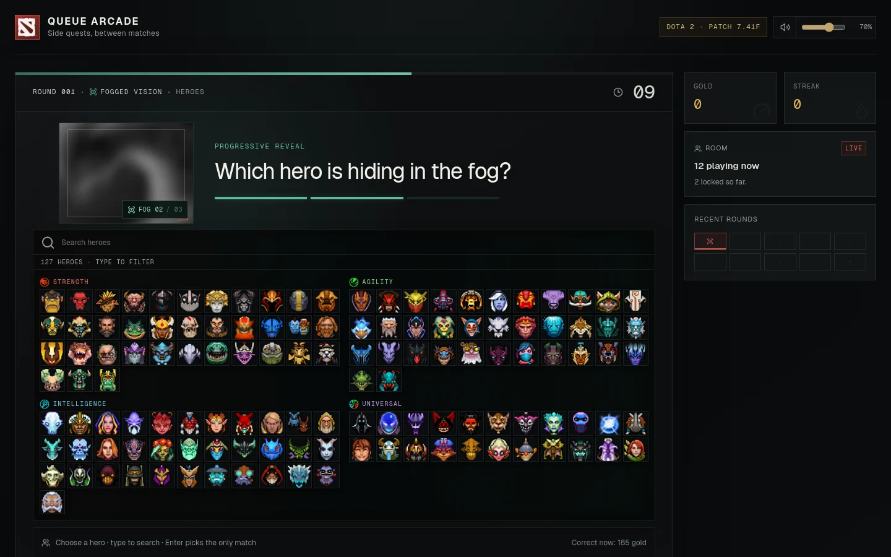
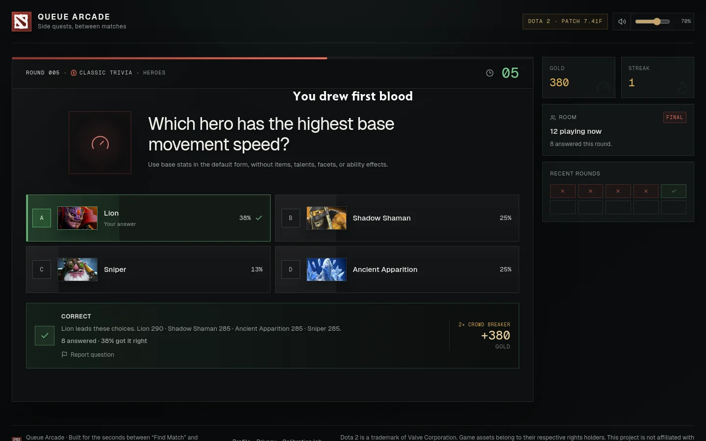
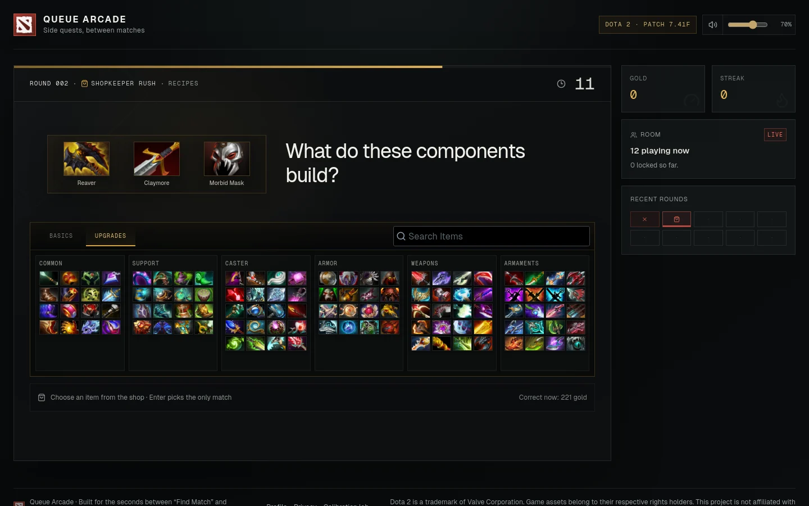
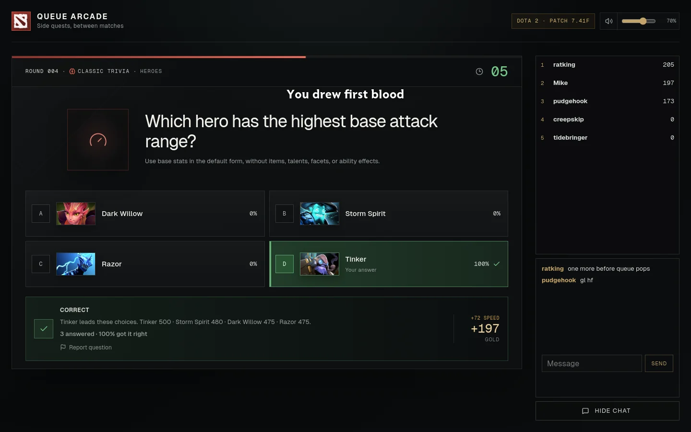
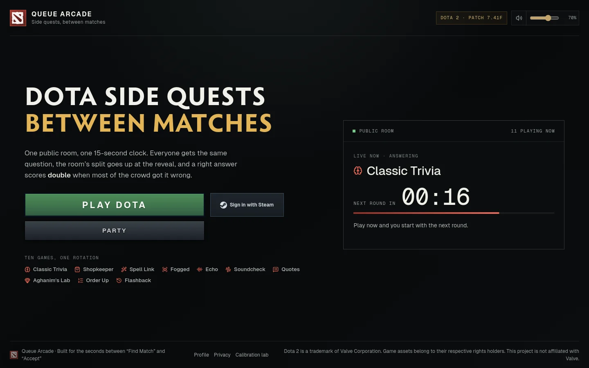

# Queue Arcade

Dota 2 trivia for the minute between Find Match and Accept.

Play it at [queuearcade.com](https://queuearcade.com). There is nothing to install and no sign-up. The site is in English and Russian: it follows your browser's language, and the switch in the header changes it.



Everyone in the room gets the same question and has 15 seconds to answer. At the reveal you see how the whole room answered. A right answer scores double when most of the room got it wrong. When your match pops, close the tab and come back at any round.

Valve had a mode like this once. Queue Trivia came with The International 2017 Battle Pass and stayed until the Battle Pass ended in 2022. Queue Arcade brings that loop back and adds new kinds of rounds.

## Round types

The room rotates through ten kinds of rounds:

| Round           | What you do                                                          |
| --------------- | -------------------------------------------------------------------- |
| Classic Trivia  | Answer questions about mana costs, cooldowns, damage and item prices |
| Shopkeeper Rush | Build an item from its parts, or find a recipe or an upgrade path    |
| Spell Link      | Name the hero behind an ability while clues unlock                   |
| Fogged Vision   | Name the hero while the portrait clears                              |
| Echo Hunt       | Name the hero from a short voice line                                |
| Soundcheck      | Name the ability or item from its sound                              |
| Quote Hunt      | Match a written quote to its hero                                    |
| Aghanim's Lab   | Name the hero from a Scepter or Shard upgrade                        |
| Order Up        | Sort items, abilities or heroes by a value                           |
| Flashback       | Answer questions about Dota and The International history            |

The game has 1,517 questions for patch 7.41f. A review in October 2026 checked each one against Valve's game data, the patch notes and dated sources.

<p>
  
  
</p>
<p>
  
  
</p>

## Parties

Open [queuearcade.com/party](https://queuearcade.com/party), pick the games and a code, and send the link to your friends. A party has its own clock, a ranking and a chat.

## Accounts

You don't need one. Without an account, your stats stay in your browser. Sign in with Steam to keep your accuracy, streaks and records for each round type across browsers. Steam sends the app your SteamID and nothing else. The [privacy page](https://queuearcade.com/privacy) lists what the app stores and for how long.

## How it works

- The server works out the current round from a fixed start time. Every browser gets the same question and deadline, and a server restart does not reset the public room. The server stores answers in Postgres.
- Answers stay on the server until the reveal. During a question the browser gets only the prompt, the choices and the clues that have unlocked. The server makes each fog stage and sound cut itself, so file names give nothing away.
- Your browser talks only to queuearcade.com. Valve's art comes through the site's own `/api/art` route, so a player's IP address never reaches Valve.
- Deploys do not stop the game. A new server waits up to 10 minutes for open parties to finish, then takes over during a reveal. See [deploys without disruption](docs/operations.md#deploys-without-disruption).
- Names and artwork come from [OpenDota](https://www.opendota.com/), voice lines and sounds through [Dotabase](https://github.com/mdiller/dotabase). Scripts in `scripts/` rebuild the question data and check it against an extract of the Dota client.

The app is built with Next.js 16, React 19, TypeScript and Postgres. It runs as one Docker container on Render.

## Run it locally

```bash
pnpm install
pnpm dev
```

Open http://localhost:3000. Without `DATABASE_URL`, answers go to a local JSON file.

`pnpm test` runs the unit tests. `pnpm check` runs the full gate, including browser checks, and needs Chrome, ffmpeg and PulseAudio.

More detail:

- [Development notes](docs/development.md) cover the data pipeline, the checks and the architecture.
- [Operations](docs/operations.md) covers deploys, hosting and backups.
- [Content sources](docs/content-sources.md) lists where each kind of question comes from.

## Credits

Names and artwork come from [OpenDota](https://docs.opendota.com/). Hero voice lines, sound effects and interface sounds come from the game files through [Dotabase](https://github.com/mdiller/dotabase). Game art comes from Valve's public asset hosts, and the site serves it from its own domain. Dota 2 and its assets are trademarks of Valve Corporation. This is a fan project. Valve does not endorse it and is not involved.

## License

The code is under the [MIT license](LICENSE). The license does not cover Valve's Dota 2 content, the Radiance font or other bundled game assets. See [NOTICE](NOTICE.md).
