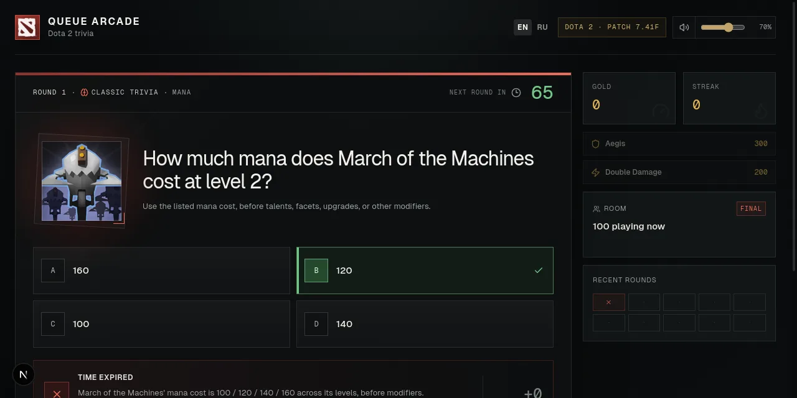
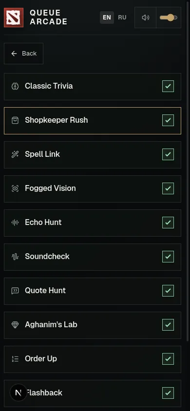
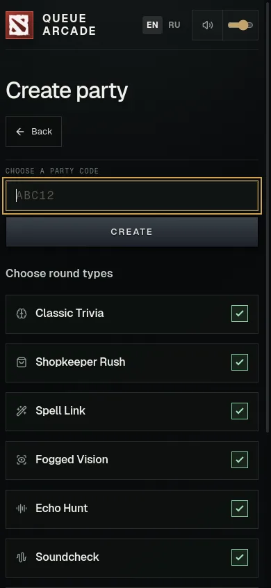

# Queue Arcade council pilot

8 November 2026. Two review rounds, one bounded UI polish pass.

## Result

| Reviewer, high effort | Baseline `ab0d4bb` | Updated UI `4aef434` |
| --- | --- | --- |
| Opus 5.5 | 7.1/10 | 8.0/10 |
| GPT-6.1 Sol | 7.5/10 | 7.7/10 |

These are subjective assessments of the inspected scope, not measured user outcomes. Keep the disagreement. The smaller Sol change is part of the result, not a reason to request another score until it rises.

The final regression cleanup came after these assessments. It removed the repeated public crowd sentence and header percentage to preserve the maintainer's [single-home decision](../../2026-11-07/simplicity.md). Those small removals were not rescored. The table applies to `4aef434`, not to a claimed independent assessment of every later commit.

The pilot supports using two reviewers to find concrete defects. It does not establish that the interface is finished or deserves a particular grade. No additional providers or paid services were used.

## Method

The project [council skill](../../../../.agents/skills/council/SKILL.md) adapts [Theo's council](https://github.com/t3dotgg/tstack/blob/main/skills/council/SKILL.md). The linked [video](https://youtu.be/xq0eB8vxeqk) supplied the user's context; the implementation used the published skill and the user's description, not an independently verified video transcript.

Both reviewers used the same [six-dimension rubric](../../../../.agents/skills/council/references/judge.md), source revision, screenshots, comparison captures, and product constraints. Each score is the mean of the assessed dimensions, rounded to one decimal.

Each round used two fresh subagent contexts. Reviewers were read-only. They did not receive the raw conversation, a desired grade, previous scores, peer reviews, or a change list. The second prompts excluded audit reports and Git history. This reduces score anchoring but does not prove that a model is unbiased.

The initial packets missed the maintainer's recent single-home constraint. The full layout gate caught the resulting repetition. The final code preserves that decision, and the saved skill and judge brief now include it. This omission limits the score comparison and is a concrete process correction for the next run.

Exact models were `claude-code/claude-opus-5-5[1m]#high` and `openai/gpt-6.1-sol#high`. Reports retain the reviewer session IDs, coverage, uncertainty, dimension scores, and findings:

- [Opus baseline](round-1-opus.md)
- [Sol baseline](round-1-sol.md)
- [Fresh Opus assessment](round-2-opus.md)
- [Fresh Sol assessment](round-2-sol.md)

## Scope and comparisons

The player scope covered home, joining, answering, answer locks, reveal, party setup, keyboard operation, and recovery. Desktop beside the Dota client is primary. Phone reflow remains supported. Operator pages appeared in the shared capture matrix but were outside the player score.

Comparisons were the rendered home and play pages of [Dotadle](https://dotadle.net/classic) and [Guess the Hero](https://www.guessthehero.com/play), captured on the same day. Both share the Dota audience. Neither has Queue Arcade's shared timed loop. Their useful patterns were concise instructions and clear clue/answer grouping. Their daily gates, limited candidate sets, confirmation steps, and phone overflow are not requirements or models to copy.

## Changes selected

| Finding | Action |
| --- | --- |
| Verdict and gold below the fold | Added a reserved verdict and gold summary beside the clock. Detailed results stay below. |
| Public crowd summary remote from the answer | Kept the split in its existing card. Repeating it elsewhere conflicted with the prior simplicity decision and was removed during the final checks. Better card placement remains a follow-up. |
| Desktop Shopkeeper hit areas overlap | Made columns respect a minimum item width and constrained buttons to their cells. Added rectangle-intersection checks. |
| Connection loss looks live | Added the retry status beside the round clock. Expired answering controls use a disabled fieldset. |
| Phone reveal clock lacks its meaning | Added a short Next label and phase-correct accessible countdown text, in English and Russian. |
| Party Enter submission and first-use layout | Added native forms, input focus, a visible creation heading, and round-type instructions. Moved code and Create before the options. |

The baseline Opus recommendation to add earned gold to every hero result was too broad. Correct hero results already had inline gold. The new summary covers all formats, including wrong and missed answers. Scoring, sound playback, the content deck, and public-room timing did not change.

## Evidence and repeatable checks

The `evidence` directory keeps selected captures as WebP images at their original dimensions, plus the responsive geometry records. WebP compression means these are not byte-identical PNG originals. The fixture views use synthetic 100-player presence, zero votes, an extended clock, and empty records. They do not represent production traffic or timing. Audio-unavailable fixture states do not prove an audio defect. Baseline captures used a development build; updated captures used a production build. Ignore the baseline-only Next development indicator.

The `observed` captures came from the fresh Opus review of real local server interactions. The single-vote reveal is not evidence of multi-player load. A full-page screenshot can extend beyond the 640 px viewport used for the interaction.

| Selected view | Baseline | Updated |
| --- | --- | --- |
| Desktop reveal |  |  |
| Phone party create |  |  |

Capture the same fixture views against an isolated local server:

```sh
APP_URL=http://127.0.0.1:3100 \
RESPONSIVE_VIEWPORTS=390x844,1280x640 \
RESPONSIVE_CASES=mana-cost,shopkeeper-build-result,spell-owner,fogged-hero,soundcheck-ability-single,flashback-year \
RESPONSIVE_ARTWORK=1 \
RESPONSIVE_SCREENSHOTS=/tmp/dota2-trivia-council/current \
node scripts/check-responsive-ui.mjs
```

The reviewed version's captures passed 136 responsive checks. Sixteen added journey cases passed against the production build. The final cases check keyboard party submission, Create visibility, non-overlapping shop targets, visible gold and verdicts, the public split's single home, timer semantics, fixed answer-section starts, expired offline controls, and reconnection. Existing Shopkeeper reveal content can expand the board below that fixed start; these assertions do not claim that every grid tile keeps its coordinates.

Run those targeted cases with:

```sh
APP_URL=http://127.0.0.1:3100 \
JOURNEY_CASE=council \
JOURNEY_EVIDENCE_DIR=/tmp/dota2-trivia-council/regressions \
node scripts/check-user-journeys.mjs
```

The mechanical design detector returned no findings on the changed components before the removal-only cleanup. ESLint, type checking, the production build, and the 21 translation/crowd-summary tests passed. After cleanup, the English and Russian layout checks each passed all 16 format cases at five widths, and the 16 targeted journey cases passed again. The [narrow script review](content-review.md) retains the existing factual review.

The full `pnpm check` gate passed on `9131d20`, including 1,310 unit tests, 68 player journeys, 2,489 responsive assertions, native sound output, and the production build and answer-leak check. See the [verification record](checks.md) for skipped upstream checks, warnings, source identity, and the saved log. Later archive-only changes do not change the checked application.

## What remains

Prioritize the reproduced keyboard search tab order and entry-wait warning placement in the next pass. Then check longer clue text, concise explanations, the complete desktop crowd split, and the short-window party roster. Test those with populated rooms and Russian copy before requesting another score.

Removing nested phone-grid scrolling is a separate design tradeoff, not an automatic fix. The full hero and item catalogs need reachable search and a visible timer. Do not replace one tested constraint based only on a reviewer's preference.

Physical phones, screen-reader output, a completed Steam login, and real multi-player crowd settlement remain unverified in this pilot. The code is pushed, but this task did not deploy it. Another model may add a different opinion; the current evidence favors checking the remaining player flows before adding council members.
